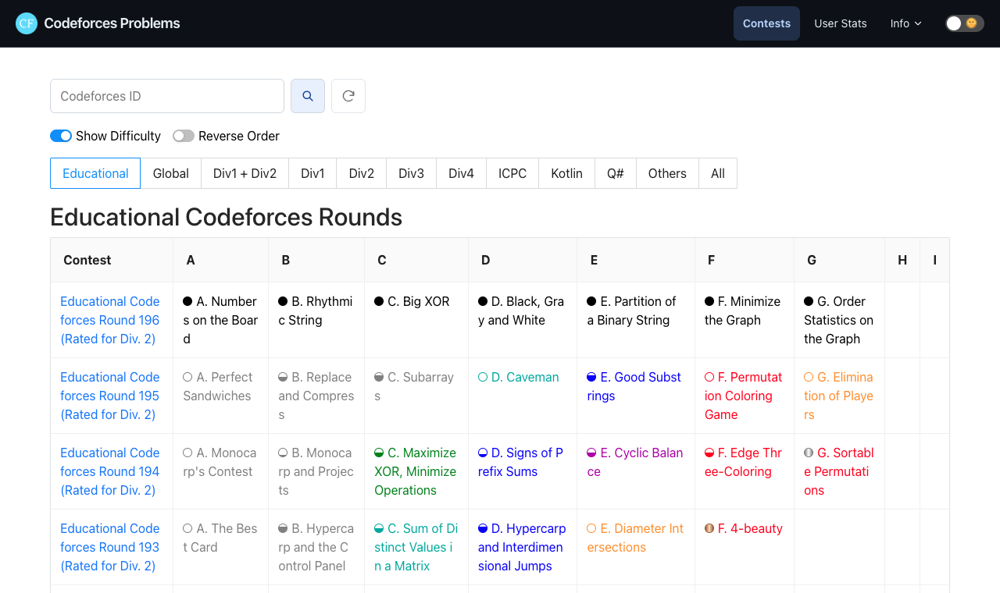

# Codeforces Problems

[Codeforces Problems](https://cf.kira924age.com) is a web application to manage your Codeforces Problems.
It is written in TypeScript with React.

This application uses [Codeforces API](https://codeforces.com/apiHelp).

## Project structure

- [`cf-problems-frontend/`](./cf-problems-frontend/README.md): the sole frontend
  application, used for local development, CI, and production deployment.
- [`cf-problems-crawler/`](./cf-problems-crawler/README.md): the daily contest-data
  collection script.

See the frontend README for Node.js requirements, development commands, tests,
and deployment instructions.

## Contribution

* [Contribution Guide](./docs/CONTRIBUTING.md)

### Found a Bug?

If you found a bug in the source code, you can help us by submitting an issue to our GitHub Repository.
Even better, you can submit a Pull Request with a fix.

### Missing a Feature?

You can request a new feature by submitting an issue to our GitHub Repository.

## Links

* [Codeforces](https://codeforces.com/)
* [kenkoooo/AtCoderProblems](https://github.com/kenkoooo/AtCoderProblems)
* [iilj/yukicoder-problems](https://github.com/iilj/yukicoder-problems)

